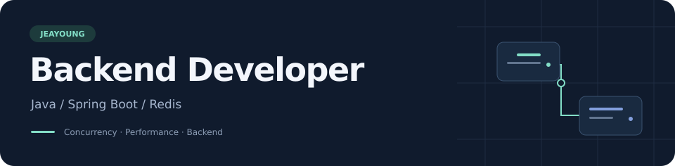

<!-- Layout references: anuraghazra/anuraghazra, DenverCoder1/DenverCoder1, zyh3699/awesome-github-readme-profile. Original text and project descriptions. -->

  

<h3 align="center">안녕하세요, 백엔드 개발자 정재영입니다.</h3>

  Java와 Spring Boot로 서비스를 개발합니다. 
  동시성 문제를 해결하고, 실행·저장 과정의 병목을 줄인 경험이 있습니다.

  
  

 

<h3 align="center">🛠 Tech Stack</h3>

  

  Java · Spring Boot · JPA · PostgreSQL · MySQL · Redis · Docker · AWS · GCP

 

### 📂 Projects

| 프로젝트 | 개발 내용 |
| :--- | :--- |
| **[SSOJ](https://github.com/jeayoung98/SSOJ)** 온라인 저지 채점 서버 | Docker 코드 실행 · SSE 진행률 전달 제출당 컨테이너 1회 실행으로 변경 → **Python 채점 약 44초 → 13초** |
| **[KMBBJ](https://github.com/jeayoung98/KMBBJ_BACKEND)** 모의 코인 거래 서비스 | 매칭 시스템 · SSE 알림 · 공통 응답 처리 Redis Lua 원자적 선점과 일괄 저장 → **평균 처리 12.74초 → 3.48초** |
| **[AI-CCAS](https://github.com/jeayoung98/AI-CCAS-)** 민원 근거 검색 모듈 · 개발 완료 | pgvector 유형별 검색 · 근거 충분성 평가 · 검색 이력 저장 유사 사례·유형 기준·공식 안내를 검색해 후속 AI에 전달 |

성능 수치와 평가 기준

- **SSOJ:** 기존 Python 100개 테스트케이스 측정 기록입니다. 현재 커밋을 반복 측정한 결과는 아닙니다. [구현·측정 근거](https://github.com/jeayoung98/SSOJ/blob/main/docs/judging-performance-and-reference.md)
- **KMBBJ:** 5,000명 동시 요청의 로컬 서비스 레이어 벤치마크에서 Redis Lua 적용 후와 Batch Insert 추가 후를 비교한 평균입니다. [비교 조건·검증 결과](https://github.com/jeayoung98/KMBBJ_BACKEND/blob/main/docs/troubleshooting/matching-queue-optimization.md)
- **AI-CCAS:** 검색 모듈 개발은 완료됐으며, 검색 임계값은 데모용 설정입니다. 실제 데이터 기반 정확도 평가와 구분합니다. [평가 기준](https://github.com/jeayoung98/AI-CCAS-/blob/main/docs/retrieval-evaluation.md)

 

### 🌱 Learning

[알고리즘·SQL 풀이](https://github.com/jeayoung98/CodingTest) &nbsp; / &nbsp; [Java](https://github.com/jeayoung98/JavaStudy) &nbsp; / &nbsp; [Spring](https://github.com/jeayoung98/SpringStudy)

  

