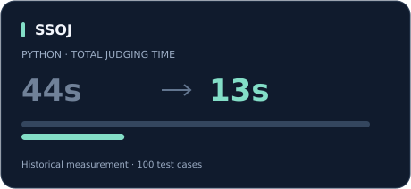
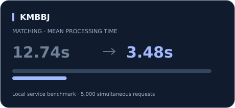

  

<h2 align="center">정재영</h2>

  Java와 Spring Boot로 백엔드를 개발합니다. 
  동시 요청에서 발생하는 매칭 오류와 채점 서버의 반복 실행 비용을 분석하고 개선했습니다.

  <a href="https://github.com/jeayoung98/SSOJ">온라인 저지</a> &nbsp;·&nbsp;
  <a href="https://github.com/jeayoung98/KMBBJ_BACKEND">모의 코인 거래</a> &nbsp;·&nbsp;
  <a href="https://github.com/jeayoung98/AI-CCAS-">민원 근거 검색</a>

 

## Projects

<table>
  <tr>
    <td width="50%" valign="top">
      
      <h3><a href="https://github.com/jeayoung98/SSOJ">SSOJ · 온라인 저지</a></h3>
      
C++·Java·Python 제출 코드를 실행하고 채점 결과를 반환하는 백엔드입니다.

      
<b>개발</b> 채점 요청 처리 · Docker 코드 실행 · SSE 진행률 전달

      
<b>개선</b> 테스트케이스마다 생성하던 컨테이너를 제출당 1회 실행으로 변경했습니다.

      
수치는 기존 Python 100개 테스트케이스 측정 기록입니다.

      
<a href="https://github.com/jeayoung98/SSOJ#채점-성능-개선">개선 과정과 구현 근거 ↗</a>

    </td>
    <td width="50%" valign="top">
      
      <h3><a href="https://github.com/jeayoung98/KMBBJ_BACKEND">KMBBJ · 모의 코인 거래</a></h3>
      
가상 자산으로 거래를 연습하고, 자산이 유사한 사용자끼리 게임을 진행하는 서비스입니다.

      
<b>담당</b> 매칭 시스템 · SSE 알림 · 공통 응답 처리

      
<b>개선</b> Redis Lua로 후보 선점을 원자화하고, Batch Insert로 DB 저장 비용을 줄였습니다.

      
5,000명 동시 요청의 로컬 서비스 레이어 벤치마크 결과입니다.

      
<a href="https://github.com/jeayoung98/KMBBJ_BACKEND/blob/main/docs/troubleshooting/matching-queue-optimization.md">매칭 개선 과정과 검증 ↗</a>

    </td>
  </tr>
</table>

<table>
  <tr>
    <td>
      <h3><a href="https://github.com/jeayoung98/AI-CCAS-">AI-CCAS · 민원 안내를 위한 근거 검색</a> &nbsp; 개발 완료</h3>
      
구조화된 민원 내용을 받아 유사 사례·유형 기준·공식 안내 문서를 검색하고, 후속 AI가 사용할 근거를 반환하는 모듈입니다.

      
<b>구현</b> &nbsp; PostgreSQL·pgvector 기반 유형별 검색 · 근거 충분성 평가 · 검색 이력 저장

      
검색 임계값은 데모용 설정이며, 실제 데이터 기반 정확도 평가와는 구분합니다.

      
<a href="https://github.com/jeayoung98/AI-CCAS-">구현 범위와 실행 방법 ↗</a>

    </td>
  </tr>
</table>

 

## Tech Stack

**Backend**

  
  
  

**Database**

  
  
  
  

**Infrastructure**

  
  
  

 

## Learning

[알고리즘 및 SQL 풀이](https://github.com/jeayoung98/CodingTest) &nbsp;·&nbsp; [Java 학습](https://github.com/jeayoung98/JavaStudy) &nbsp;·&nbsp; [Spring 학습](https://github.com/jeayoung98/SpringStudy)

